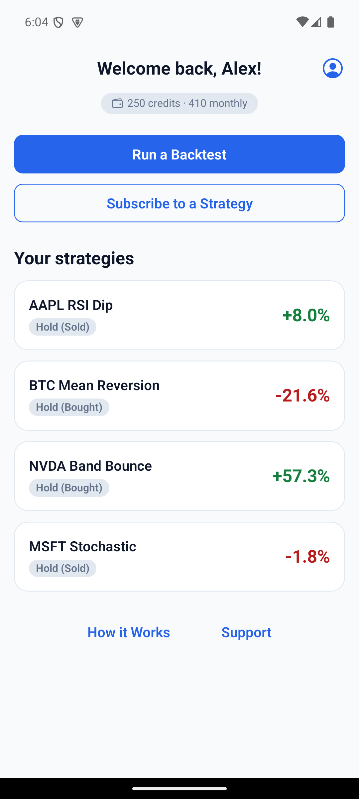
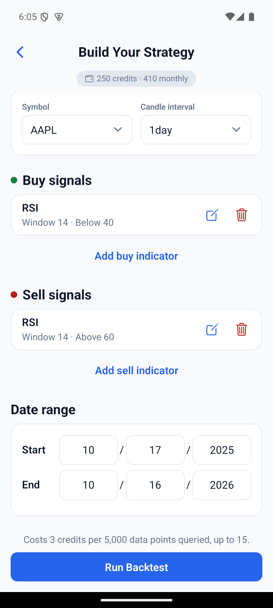
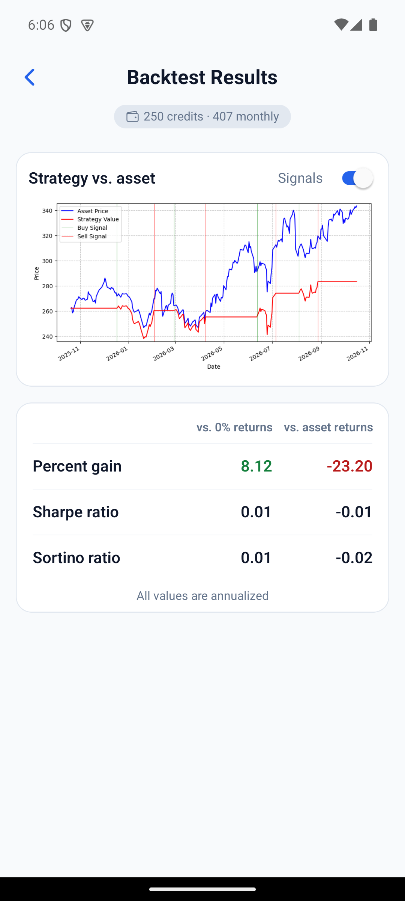
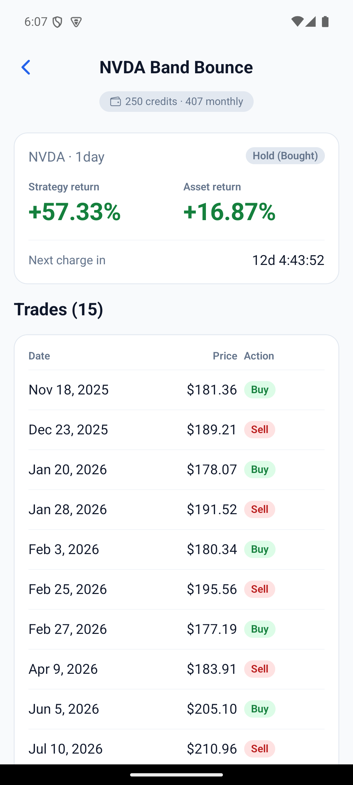

# AlgoTracker

Mobile app for building simple technical-indicator trading strategies, back-testing them on historical price data, and subscribing to a strategy so you get a push notification when it signals a trade. Built with Expo / React Native; the API lives in [AlgoTrackerBackend](https://github.com/bsav0016/AlgoTrackerBackend).

<p>   </p>

*Screenshots are from the Android build running against a local copy of the backend with a demo account and real historical prices. The positions, returns and trades on the home and strategy screens are each strategy's one-year backtest result, not live signals. More in [docs/screenshots](docs/screenshots) (for example the [signal builder](docs/screenshots/signal-builder.png)).*

## Project status

**This is a portfolio project and it is not currently connected to a live backend.** The production API server is paused, so a build of this app has nothing to sign in to unless you run the backend yourself.

- **What works without any accounts:** type-checking and the Jest tests (`npm test`) need no keys, no network and no backend.
- **To run the app end to end** you need the [AlgoTrackerBackend](https://github.com/bsav0016/AlgoTrackerBackend) running locally and your own keys: a Stripe publishable key for card payments, and RevenueCat keys for store purchases. A development build is required, because the app uses native modules (Stripe, RevenueCat, notifications) that Expo Go does not include.
- **No secrets are stored in this repository.** The values in `.env.example` are placeholders, and the Stripe key is a publishable key (`pk_...`), which is meant to ship inside an app. The one RevenueCat key in the code (`APIKeys` in `app/(screens)/deposit-funds-screen.tsx`) is RevenueCat's public SDK key for the original project, which is also designed to ship inside an app. Replace it, and the Google placeholder next to it, with keys from your own RevenueCat project. It is hard-coded rather than read from the environment, which is a known shortcut.

## Why it exists

Trying out a technical-indicator trading idea usually takes code or a desktop charting tool. AlgoTracker lets you assemble a strategy from standard indicators on your phone, back-test it on historical prices, and subscribe to it so you get a push notification when it signals a trade instead of watching charts.

## What it does

- **Build a strategy** – pick a symbol and an interval, then define buy and sell conditions from seven indicators: RSI, SMA and EMA (vs. current price), MACD vs. signal, Stochastic Oscillator, Bollinger %B, and ADX, each with its own window and target settings.
- **Run a backtest** – the backend replays the strategy over historical data; the app shows the resulting trades and return figures.
- **Subscribe to a strategy** – the home screen lists your subscriptions with their current position and return, and the backend sends push notifications on signals (via `expo-notifications`).
- **Share a strategy** – the strategy screen has a Share button that makes a public link (`<API address>/s/<id>`, a web page with a preview card) and opens the phone's share sheet, and a Stop sharing button that turns the link off. Opening a link in the app (`algotracker://shared/<id>`) shows the strategy's rules and results with an "Add to my strategies" button, which copies it into your account as a free, inactive draft; open the draft and tap Start tracking to begin. A link opened before sign-in waits until you are signed in. Opening a link straight from a message into the app needs Apple associated domains and Android app links, which are not set up yet; until then the web page's button opens the app only if it is installed.
- **Leaderboard** – a screen (reached from the home screen) ranks strategies by return over buy-and-hold, on an all-time board and a last-week board with older weeks, for daily-or-longer and intraday strategies separately, with your own place shown even when you are not near the top. It is opt-in: nobody appears until they pick a board name (3 to 20 plain characters, never the real name), and leaving deletes the name and past entries. Other users see only a name, rank and results, never rules. Only live results count, and a strategy needs 14 days live and 3 completed trades to rank.
- **Credits** – backtests and subscriptions cost credits. Credits are bought with a card (Stripe) or through in-app purchases (RevenueCat). The symbol list, intervals and prices come from the backend.
- **Accounts** – register, log in with JWT, reset a password by email, delete the account.
- A "How it Works" screen explains each indicator input and output.

## Stack

- Expo SDK 53, React Native 0.79, TypeScript, `expo-router` (file-based routing)
- `@stripe/stripe-react-native`, `react-native-purchases` (RevenueCat), `expo-notifications`, `expo-secure-store`
- Jest for tests

## Running it

You need a running backend (see the backend README) and a development build, because the app uses native modules (Stripe, RevenueCat, notifications). Expo Go will not work. Requires Node 18+.

```bash
npm install
cp .env.example .env     # PowerShell: Copy-Item .env.example .env
npm start                # then: npm run android  /  npm run ios
```

The scripts contain no shell-specific syntax, so they run the same on Windows, macOS and Linux.

### Configuration

Settings come from `.env` (git-ignored; Expo loads it automatically, and you need `npx expo start --clear` after editing it). `app.config.js` reads them through `config/resolveConfig.js`; nothing needs editing in source.

| Variable | Purpose | Default |
| --- | --- | --- |
| `API_URL` | Backend address, e.g. `http://192.168.1.20:8000/` | `http://localhost:8000/` |
| `STRIPE_PUBLIC_KEY` | Stripe **publishable** key (`pk_test_...`), only needed to try card deposits | none |

`localhost` only works for the iOS simulator and web. Use `http://10.0.2.2:8000/` for the Android emulator, or your computer's LAN IP on a physical phone. Android builds also need a `google-services.json` (Firebase), which is not committed.

Production builds (`npm run build-prod`, which runs `eas build --profile production`) set `APP_ENV=production` through `eas.json`, and use the deployed API and live publishable key automatically. Set `API_URL` / `STRIPE_PUBLIC_KEY` in the EAS build environment to override them.

### Tests

```bash
npm test             # one run (CI-friendly)
npm run test:watch   # re-run on change
npm run lint         # expo lint (ESLint); existing warnings are tolerated, errors fail
npm run typecheck    # tsc --noEmit (clean; CI fails on any error)
```

The tests cover environment resolution (`config/resolveConfig.test.js`) and API error handling (`lib/networkRequests/NetworkRequest.test.ts`). They mock `fetch` and never contact a backend.

### CI

`.github/workflows/ci.yml` runs on pull requests and on pushes to `master`: `npm ci` (from the committed `package-lock.json`, Node version from `.nvmrc`), a check for hard-coded private URLs or secret keys, lint, type-check (must pass), tests, and a production JavaScript bundle (`expo export`). It needs no secrets. Store builds are not part of CI; releases stay manual with `npm run build-prod`. Commit changes to `package-lock.json` along with `package.json`.

## Design decisions

- **Backtesting on the server.** Pricing data, indicators and metrics are computed by the backend (pandas); the app only configures strategies and renders results.
- **Credits instead of subscriptions-per-feature.** Usage costs come from the backend (`backtestBaseCost`, `backtestIterations`), so pricing can change without an app release.
- **Two payment paths.** Stripe for card payments and RevenueCat for store purchases, both crediting the same account balance.
- **One small design system.** Colors (light and dark), spacing, radii and type sizes live in `constants/Colors.ts` and `constants/Theme.ts`; shared pieces (`Card`, `Badge`, `TextField`, `SelectField`, `SegmentedControl`, `GeneralButton`) live in `components/`. Screens use those instead of hard-coded styles.
- **Config chosen by EAS build profile**, so the production build uses the production API and live Stripe key without code changes.

## Limitations

- Back-test results are historical simulations, not investment advice.

## License

MIT. See [LICENSE](LICENSE).
